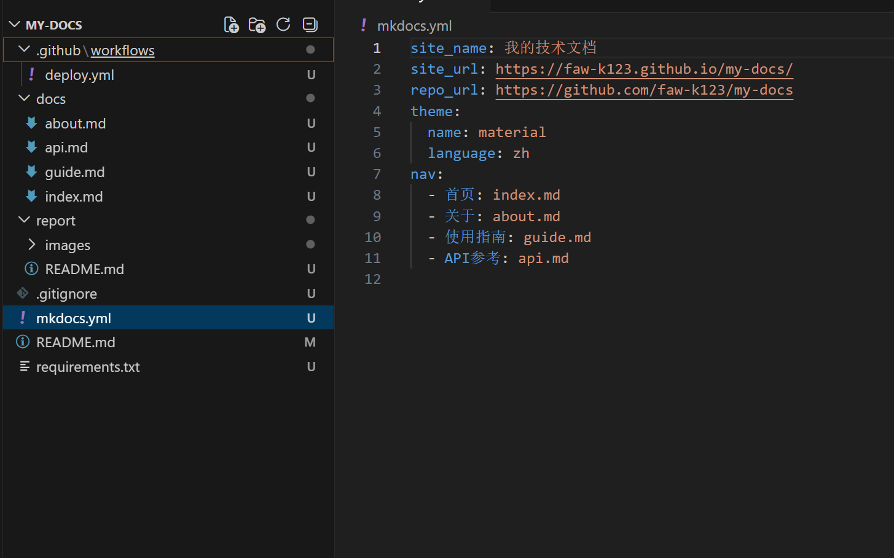

# 实践项目 2：个人实验报告

## 1. 基本信息

- GitHub 登录名：faw-k123
- 个人仓库地址：`https://github.com/faw-k123/my-docs`
- 最终网站地址：`https://faw-k123.github.io/my-docs/`
## 2. 实践过程与关键截图
2.1 仓库创建

2.2 项目结构与 MkDocs 配置

创建目录结构，编写docs下4个md页面，配置mkdocs.yml、requirements.txt、.gitignore。
docs目录存放Markdown源码文档；
mkdocs.yml中的nav用来定义网站顶部导航菜单，导航路径是相对于docs文件夹；
site目录为mkdocs build自动生成的静态网页构建产物，每次构建会覆盖，不提交到git，不手动修改。

2.3 本地构建或预览

执行`python -m mkdocs serve`启动本地预览服务，访问 `http://127.0.0.1:8000/my-docs/` 预览文档网站，程序会监听文档文件变化，支持实时刷新。
终端黄色文字是Material主题的生命周期提醒，不影响功能。首页、关于、使用指南、API参考等页面均可正常跳转浏览。

2.4 Pages 设置

进入仓库 `Settings → Pages`，在 Build and deployment 区域将 Source（发布来源）设置为 **GitHub Actions**，页面提示 `GitHub Pages source saved.`，代表配置保存成功。
随后进入 `Settings → Actions → General`，确认仓库允许执行项目的 Actions 工作流。
> 本方案在工作流文件内直接授予部署权限，无需修改仓库全局读写权限，也不需要勾选 `Allow GitHub Actions to create and approve pull requests`。

2.5 Actions 首次构建和部署
push：配置触发条件。当向`main`分支推送代码，并且改动的文件在指定路径（文档、mkdocs 配置、依赖文件、工作流脚本）时，流水线才会自动启动。如果仅仅修改 README 或者作业报告图片，不会触发本次自动构建部署。
workflow_dispatch：开启手动触发流水线的能力。可以直接在 GitHub 仓库的 Actions 网页界面点击按钮手动运行工作流，方便部署失败时重试、调试排查问题。
build 任务：流水线的构建阶段。依次完成拉取项目源代码、搭建 Python 运行环境、安装项目依赖包、执行 mkdocs 命令编译生成静态站点`site`目录，最后把生成好的静态网页打包上传，作为部署产物。
needs: build：任务依赖控制。`deploy`部署任务必须等待前面`build`构建任务执行成功之后才会开始运行；一旦构建出错，部署步骤不会执行，避免上传无效的网页文件。
pages: write、id-token: write：权限声明，给流水线授予操作 GitHub Pages 服务的必要权限，使其能够上传静态页面、完成网站发布。
github-pages：GitHub 内置的部署环境，用于管理本次 Pages 部署记录，同时生成最终可访问的在线网页地址

2.6 网站访问与四页导航检查

代码推送 main 分支后，GitHub Actions 自动触发`Deploy MkDocs to GitHub Pages`工作流，流水线状态为 Success，build 与 deploy 任务均执行成功。

访问部署站点`https://faw-k123.github.io/my-docs/`，依次访问首页、关于、使用指南、API 参考页面。全部页面加载正常，侧边导航菜单跳转顺畅，表格、代码块等 Markdown 元素渲染正常，无 404 链接。

2.7 第二次推送与自动更新验证
- 对应提交链接：[https://github.com/faw-k123/my-docs/commit/f31e5b98f72a051aa39b179bdf0dc03f29244a10](https://github.com/faw-k123/my-docs/commit/f31e5b98f72a051aa39b179bdf0dc03f29244a10)
- 对应 Actions 运行链接：[https://github.com/faw-k123/my-docs/actions/runs/42036319967](https://github.com/faw-k123/my-docs/actions/runs/42036319967)

修改`docs/index.md`首页文档，添加可识别验证文字：`自动部署验证：这是我第二次推送后更新的内容。`
执行 git 提交推送命令，本次推送自动触发 GitHub Actions 流水线，**不手动触发部署**。等待流水线执行成功，使用无痕窗口访问站点，页面成功展示新增文本，验证自动更新生效。

## 3. 问题与解决

本次实践过程未遇到严重错误。主要核对了 Actions 工作流日志，确认 build 阶段 mkdocs 编译正常，静态产物打包上传成功；同时排查浏览器缓存问题，在验证自动更新时，使用无痕窗口避免旧页面缓存干扰，保证能看到最新部署内容。

## 4. 原理理解
1. docs/ 和 site/ 各保存什么？为什么不用手工修改 site/？

> 
> `docs/`：存放编写的 Markdown 源文档，是人工维护编写的原始内容；
> `site/`：mkdocs build 自动编译生成的静态 HTML、CSS、JS 网页文件，是最终用于发布的网页产物。
> 每次执行 mkdocs build 都会**覆盖重写 site 目录**，手动修改 site 里的文件会在下一次构建时丢失，因此不需要、也不能手工修改 site 目录，只维护 docs 下的源码即可。

2. 本次工作流在什么情况下自动运行？

> 
> 向 main 分支推送代码，且修改的文件匹配工作流配置的路径（mkdocs.yml、docs/**、requirements.txt、workflow 文件等）时自动触发；仅修改不在匹配路径中的文件（例如只修改 report/README.md），不会自动触发流水线。同时支持网页上手动点击 workflow_dispatch 触发。

3. build 与 deploy 两个任务有什么区别？

> 
> build：拉取代码、搭建环境、安装依赖，调用 mkdocs 编译 Markdown 文档生成静态网页，打包并上传构建产物。
> deploy：等待 build 成功后，将 build 产出的静态站点部署发布到 GitHub Pages 服务，对外提供网站访问。

4. 只修改 report/README.md 会触发部署吗？为什么？

> 
> 不会触发。工作流的 push 触发配置限定了监控的文件路径，report/README.md 不在触发路径范围内，修改该文件不会触发流水线自动运行。

5. 本次方案为何无需创建 gh-pages 分支？

> 
> 新版 GitHub Pages 支持直接从 GitHub Actions 部署，静态产物临时存储在流水线的 artifact 中，不再依赖单独的 gh-pages 分支存放网页文件，因此不需要手动创建 gh-pages 分支

